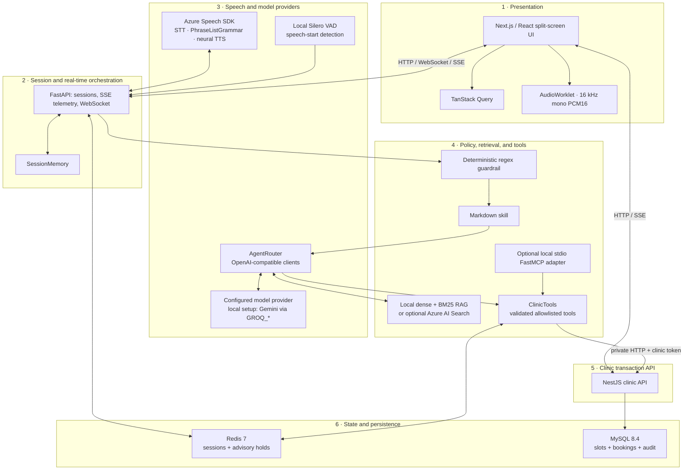
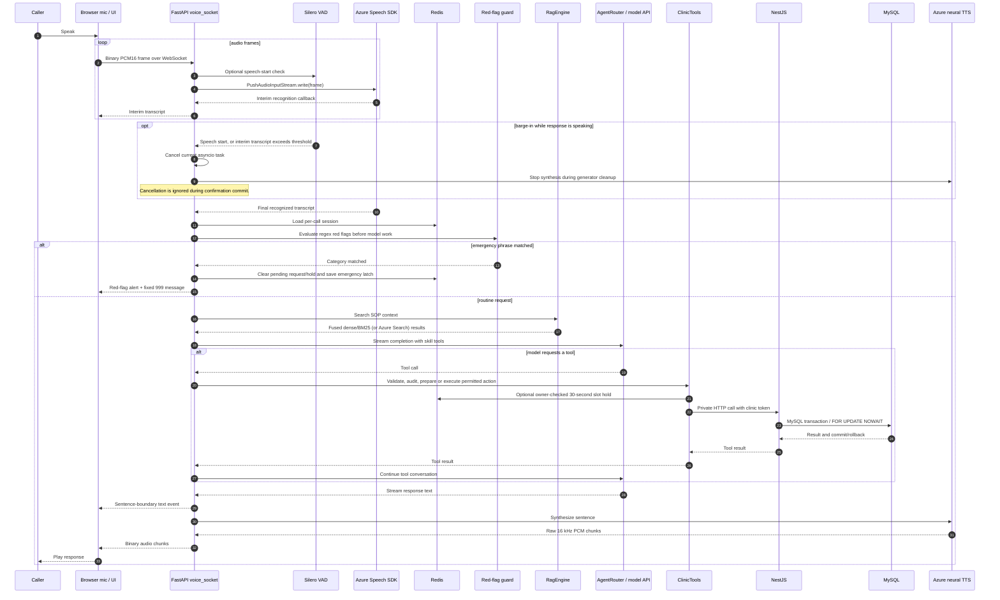

# Healthcare Voice & Triage Receptionist

## Purpose and implementation status

This guide describes the code currently in this workspace and gives a local
build/demo runbook. It distinguishes implemented behavior from targets and
production ideas. It is not a clinical safety case, a compliance statement, or a
deployment specification for real patient data.

The local application is a fictional-clinic proof of concept. Its main services
are defined in [`docker-compose.yml`](./docker-compose.yml). The original
design sketch is [`voice_agent_copilot_implementation_spec.md`](./voice_agent_copilot_implementation_spec.md);
where the sketch differs from executable code, this guide follows the code.

## 1. Executive summary and engineering pillars

| Reception challenge | What this implementation does | Evidence and limits |
|---|---|---|
| Open-ended voice intake with a sub-800 ms Time-to-First-Audio (TTFA) target | The browser streams mono PCM16 audio to the FastAPI WebSocket. Azure Speech provides interim/final recognition and streamed neural speech output. The orchestrator yields model text as it arrives and sends complete sentence chunks to speech synthesis. | `ttfa_ms` is an observed per-turn metric in [`ai-orchestrator/app/main.py`](./ai-orchestrator/app/main.py); it starts after a final transcript reaches the server. The README calls `<800 ms` a target, not a guarantee. There is no benchmark or service-level objective proving sub-800 ms end-to-end performance. |
| Deterministic clinical safety and compliance (NHS DTAC, DCB0129, UK GDPR) | A small Python regex guard runs before retrieval/model calls. A match bypasses the LLM, latches an emergency state for that call, clears pending work, emits an alert, and returns a fixed message advising the caller to call 999. | [`evaluate_clinical_red_flags()`](./ai-orchestrator/app/pipeline/guardrails.py) is a demonstration guardrail, not clinical assessment or escalation. It can miss emergencies and can trigger on negated/historical wording. This repository does **not** establish NHS DTAC, DCB0129, or UK GDPR compliance. |
| High-precision hybrid retrieval for clinic SOPs and medication rules | [`RagEngine`](./ai-orchestrator/app/rag/ingest.py) chunks Markdown SOPs and combines local dense embedding and BM25 rankings with pure-Python RRF. An optional Azure AI Search mode also combines vector and sparse rankings. | RRF is rank fusion, not a cross-encoder reranker. The code has limited local candidate filters, not a calibrated end-to-end confidence threshold. Retrieval reduces unsupported answers but cannot guarantee that drug names or policies are never hallucinated. |
| High-concurrency transactional slot booking without double-booking | The orchestrator obtains a 30-second advisory Redis hold before asking for confirmation. NestJS then uses a MySQL transaction with `SELECT ... FOR UPDATE NOWAIT`, rechecks availability, writes the booking and audit record, and commits with an idempotency key. | MySQL is the authoritative booking state; Redis does not lock the database slot. Contending locks fail fast and are handled as conflicts. The UI refreshes committed data through SSE-triggered query invalidation and 15-second polling. |

### Terms used in this guide

- **Implemented** means there is an executable code path in this workspace.
- **Target** means a stated goal or measured observation that is not an SLA.
- **Roadmap** means a possible production design; it is not deployed or
  provisioned by this repository.

## 2. System architecture diagrams

### Diagram A: six-layer system architecture

```text
┌──────────────────────────────────────────────────────────────────────────┐
│ 1. PRESENTATION                                                          │
│ Next.js / React split screen: Caller Web Phone + Receptionist Dashboard  │
│ TanStack Query fetches health, available slots, and committed bookings.  │
│ Browser mic capture: AudioWorklet → 16 kHz mono PCM16.                   │
└───────────────────────────────┬──────────────────────────────────────────┘
                                │ HTTP / SSE / WebSocket
┌───────────────────────────────▼──────────────────────────────────────────┐
│ 2. SESSION AND REAL-TIME ORCHESTRATION                                  │
│ Python FastAPI: POST /api/sessions, /api/telemetry (SSE), /ws/voice.     │
│ Redis-backed call memory, one active browser connection, async turns.   │
└──────────────┬─────────────────────────────────────┬─────────────────────┘
               │ audio / transcripts                 │ transcript / turn
┌──────────────▼─────────────────────┐  ┌────────────▼─────────────────────┐
│ 3. SPEECH AND MODEL PROVIDERS       │  │ 4. POLICY, RETRIEVAL, AND TOOLS │
│ Azure Speech SDK: STT, PhraseList-  │  │ Python regex red-flag guard;    │
│ Grammar, raw PCM neural TTS.        │  │ Markdown skill; local hybrid   │
│ Local Silero VAD detects speech     │  │ RAG / optional Azure AI Search;│
│ starts; it is not Azure VAD.        │  │ AgentRouter → allowlisted tools│
│                                     │  │ Optional local stdio FastMCP.  │
│ Configurable OpenAI-compatible LLM │  │                                 │
│ clients. Current local setup uses   │  │ FastMCP is an adapter, not the │
│ Gemini through GROQ_* config.       │  │ normal model tool-call path.   │
└───────────────────┬─────────────────┘  └────────────────┬────────────────┘
                    │                                      │ HTTP + token
                    └──────────────────────────────────────▼───────────────┐
┌──────────────────────────────────────────────────────────────────────────┐
│ 5. CLINIC TRANSACTION API                                                │
│ NestJS: availability, booking confirmation, prescription, audit, events. │
│ Validates private mutations and coordinates MySQL transactions.         │
└─────────────────────────────────┬────────────────────────────────────────┘
                                  │
┌─────────────────────────────────▼────────────────────────────────────────┐
│ 6. STATE AND PERSISTENCE                                                 │
│ Redis 7: call state, active-call lease, temporary slot holds.            │
│ MySQL 8.4: synthetic slots, bookings, prescriptions, and audit records.   │
│ Redis in this Compose stack is volatile; MySQL uses a named volume.      │
└──────────────────────────────────────────────────────────────────────────┘

External runtime dependencies: Azure Speech; selected OpenAI-compatible model
provider; optionally Azure AI Search. All five application/data services above
are containerized by Docker Compose and bound to localhost ports.
```



**Model naming caveat:** the implementation has two generic OpenAI-compatible
client slots (`GITHUB_*` and `GROQ_*`) in
[`AgentRouter`](./ai-orchestrator/app/pipeline/llm_router.py). It does not have
separate GPT-4o, LLaMA 3, or Mistral adapters. GitHub Models was retired in July
2026. This workspace's local `.env` routes to Gemini using the `GROQ_*` variable
names and the Gemini OpenAI-compatible endpoint. The names are configuration
slots, not a claim that the provider is Groq. Model availability and API billing
are provider-specific.

**FastMCP caveat:** the normal WebSocket path calls `ClinicTools` directly from
`AgentRouter`. [`app/mcp_tools/server.py`](./ai-orchestrator/app/mcp_tools/server.py)
is an optional local stdio adapter; it is not a deployed network MCP service.

### Diagram B: one voice turn and interruption sequence

The timeline below is ordered, not a millisecond performance claim. The
implementation does not measure isolated `<3 ms` red-flag execution or `<2 ms`
Redis reads. It reports `first_text_ms`, `ttfa_ms`, and `total_ms` from the
orchestrator after a final transcript arrives; browser capture, speech endpointing,
network transfer, and browser playback are not included in that server timer.

```text
Illustrative timeline (durations depend on device, network, provider, and input)

T+0                 Browser AudioWorklet captures microphone PCM16
                    16 kHz · mono · 16-bit
  │
  ├─ continuously ─► WebSocket binary audio ─► FastAPI voice_socket()
  │                                         ├─► Silero VAD speech-start check
  │                                         └─► Azure PushAudioInputStream.write()
  │
  ├─ Azure interim result ─► browser transcript/status
  │                         └─ if caller is speaking: cancel active response
  │                            (unless an irreversible confirmation commit is active)
  │
  └─ Azure final result ─► submit turn ─► Redis SessionMemory.load()
                                           └─► deterministic red-flag regex
                                               ├─ match: latch emergency, clear
                                               │  pending hold, alert and return
                                               │  fixed 999 message; no model call
                                               └─ no match: RAG lookup, then
                                                  configured model request
                                                  ├─ stream model text
                                                  ├─ if a tool is needed, execute
                                                  │  tool and send result back
                                                  └─ yield punctuation-delimited
                                                     sentence chunk(s)
                                                        └─ Azure Neural TTS
                                                           raw PCM callbacks
                                                           └─ WebSocket audio
                                                              └─ browser playback
```



There is **no separate latency-masking filler-phrase subsystem** in the current
code. The router waits for a model tool call, executes the tool, and continues the
model round. A short LLM sentence can stream before the rest of the response when
the provider emits text first, but the application does not promise filler audio
during tool execution.

## 3. Implementation walkthrough

### A. Real-time voice cascade and latency engineering

1. **Browser capture and transport.** The
   [`AudioCapture`](./clinic-dashboard-nextjs/src/lib/audio.ts) helper requests
   microphone access and sends PCM frames through the WebSocket. The browser
   worklet is [`pcm-capture-worklet.js`](./clinic-dashboard-nextjs/public/pcm-capture-worklet.js).
   Audio is 16 kHz mono PCM16, not WebM or Opus. The browser must permit
   microphone access for `http://localhost:3000`.
2. **WebSocket lifecycle.** [`voice_socket()`](./ai-orchestrator/app/main.py)
   accepts a call ID and token, checks the configured origin and Redis-backed
   call authorization, permits one active connection, then handles text, binary
   audio, and control events. Final Azure recognition submits a turn. The
   per-turn `run_turn()` task loads Redis memory, applies safety checks, then
   performs model/tool work.
3. **Speech recognition and synthesis.**
   [`AzureVoiceBridge`](./ai-orchestrator/app/speech/azure_speech.py) configures
   Azure from `AZURE_SPEECH_KEY` and `AZURE_SPEECH_REGION`, creates a
   `PushAudioInputStream` for 16 kHz, 16-bit, mono PCM, and sets recognition
   language and synthesis voice from `.env`. Its `PhraseListGrammar` adds
   clinical terms including medication names, clinician names, and “repeat
   prescription”; it biases recognition but does not guarantee transcription.
   The class streams `Raw16Khz16BitMonoPcm` synthesis output through callbacks.
4. **VAD and barge-in.** [`SileroDetector`](./ai-orchestrator/app/speech/vad.py)
   is local speech-start detection, not Azure VAD and not speech-end detection.
   When enabled, the server may interrupt a current response on detected speech;
   an Azure interim transcript can also interrupt. `_interrupt()` cancels the
   active turn except while a confirmation commit is in progress. Cleanup stops
   active synthesis. This is an implementation hook, not a measured
   full-duplex/barging guarantee.
5. **Sentence streaming and metrics.** [`stream_sentences_from_tokens()`](./ai-orchestrator/app/pipeline/sentence_chunker.py)
   uses the regex `(?<=[.!?])\s+` to emit text at period, exclamation-mark, or
   question-mark boundaries rather than waiting for the entire completion.
   A colon is not a sentence boundary in this implementation. Azure TTS is then
   started sentence-by-sentence. The UI displays `first_text_ms`, `ttfa_ms`, and
   `total_ms`; these are server-side observations after final STT, not end-to-end
   latency proof. TTFA below 800 ms is a target only.

### B. Model routing and declarative voice prompting

- [`AgentRouter`](./ai-orchestrator/app/pipeline/llm_router.py) creates clients
  for whichever of the two configured providers has a non-empty key. It uses a
  booking/clinical keyword regex and recent tool-call history to classify a turn
  as complex. If the GitHub client is configured, complex turns use
  `PRIMARY_REASONING_MODEL`; simple turns use the second provider if available.
  If GitHub is absent, the second provider handles **all** turns. There is no
  learned intent classifier, load balancer, provider health check, or automatic
  retry against another provider.
- **Current local configuration:** Gemini is configured through
  `GROQ_API_KEY`, `GROQ_BASE_URL`, and `FAST_ROUTER_MODEL` because Gemini exposes
  an OpenAI-compatible endpoint. This is a configuration alias, not a Groq
  integration. The current model must support streaming and tool calling.
  GitHub Models is retired; `openai/gpt-4o`, LLaMA 3, and Mistral are not active
  provider guarantees in this code.
- The voice policy is
  [`gp_triage_skill.md`](./ai-orchestrator/app/skills/gp_triage_skill.md).
  [`load_markdown_skill()`](./ai-orchestrator/app/skills/loader.py) parses YAML
  frontmatter and Markdown instructions into a Pydantic `DeclarativeSkill`;
  invalid/extra frontmatter fields are rejected. The skill controls the
  instruction text, temperature, output token cap, and allowed tool names. Its
  prompt asks for short spoken replies, limits answer length, forbids diagnosis
  and clinical approval, and requires identity/details to be read back and
  explicitly confirmed before a booking is committed.
- The model router streams text and accumulates tool-call fragments. It preserves
  provider-specific `extra_content` metadata returned with tool calls, including
  Gemini thought signatures needed for continued tool exchanges. The presence
  of these safeguards does not make model output or prompt files independently
  certified.
- Availability results are treated as data from the clinic API: the orchestrator
  drops a past year inferred by the model when the caller did not state a year,
  and asks the model to correct an explicitly past date. If the model returns no
  text after a successful availability lookup,
  [`AgentRouter._format_availability_result()`](./ai-orchestrator/app/pipeline/llm_router.py)
  speaks up to two slots from the tool result rather than inventing availability.

### C. Hybrid RAG and unsupported-answer reduction

- Source documents live in [`sops/`](./sops); the current demonstration source is
  [`clinic-demo.md`](./sops/clinic-demo.md). Do not add real clinical records.
- The sample SOP documents synthetic-demo scope, weekday opening hours,
  appointment confirmation, lack of cancellation support, repeat-prescription
  limits, and boundaries on medical advice. Those facts make useful, checkable
  retrieval questions.
- [`chunk_markdown()`](./ai-orchestrator/app/rag/ingest.py) divides Markdown by
  headings, then creates overlapping text windows. For local mode,
  `RagEngine` initializes the configured sentence-transformer embedding model,
  normalizes dense vectors, and builds a BM25 index over lowercase word tokens.
- Local search ranks dense similarity candidates and BM25 candidates separately,
  filters the local candidate lists, and merges rankings with
  [`reciprocal_rank_fusion()`](./ai-orchestrator/app/rag/hybrid_rrf.py). The
  current RRF uses a rank constant of 60 and returns a small top set. Azure mode
  sends separate sparse and vector queries to Azure AI Search and applies the
  same RRF. `RAG_MODE=off` returns no SOP context.
- The router inserts retrieved text as **untrusted administrative SOP context**.
  This supports grounded responses but is not a guarantee of factuality.
- **Not implemented:** cross-encoder reranking, a calibrated retrieval
  confidence threshold, evaluation-based abstention, or a guarantee that exact
  medication/policy facts cannot be hallucinated.
- The embedding model may be downloaded on first local RAG use. No Azure AI
  Search resource is required when using local RAG or `RAG_MODE=off`.

### D. Deterministic safety guardrails and compliance boundary

- [`evaluate_clinical_red_flags()`](./ai-orchestrator/app/pipeline/guardrails.py)
  checks recognized text with case-insensitive regular expressions for chest
  pain, stroke, breathing distress, and other crisis phrases. The code executes
  this before RAG and LLM work in `run_turn()` in
  [`app/main.py`](./ai-orchestrator/app/main.py).
- A match triggers a fixed message advising a call to 999, sets a Redis-backed
  emergency latch for that call, clears pending actions/holds, emits a red-flag
  event, attempts an audit record, and bypasses the model. Routine clinic tools
  are blocked while emergency mode remains latched.
- This is a narrow demonstration rule set: it does not understand negation or
  context, can false-trigger, can miss emergencies, does not contact emergency
  services, and does not transfer to a clinician. It is not clinical triage.
- **PII and privacy:** the app is intended for synthetic data only. Call history
  is stored in Redis for a sliding one-hour lifetime; booking and audit fields
  persist in MySQL. Local tokens and origin checks are not production identity
  controls. The repository has no production-grade identity/RBAC, TLS,
  encryption-at-rest design, retention policy, DPIA, or verified UK GDPR
  controls. Do not enter real patient information.
- **Compliance:** no NHS DTAC assessment, DCB0129 clinical safety case, hazard
  log, clinical evaluation, or regulatory approval is included. These names are
  review obligations, not properties established by this prototype.

### E. Microservice boundaries, tools, and concurrency

- **Python orchestrator:** [`app/main.py`](./ai-orchestrator/app/main.py)
  handles calls, safety, session state, speech, model streaming, telemetry, and
  tool orchestration. [`ClinicTools`](./ai-orchestrator/app/mcp_tools/clinic_tools.py)
  validates tool JSON with Pydantic schemas, audits actions, obtains/clears
  advisory Redis holds, and calls the clinic API.
- **Optional FastMCP:** [`app/mcp_tools/server.py`](./ai-orchestrator/app/mcp_tools/server.py)
  exposes the same local tools over stdio when explicitly run. It is not
  automatically registered in an editor configuration and is not the primary
  model-to-tool route. Its browser/call ownership checks require an existing
  call; it cannot bypass normal booking confirmation.
- **NestJS clinic backend:** [`BookingsController`](./clinic-backend-nestjs/src/bookings/bookings.controller.ts)
  exposes health, availability, bookings, private booking/prescription/audit
  mutations, and events. Private mutations require `x-clinic-token`.
  [`BookingsService.bookSlot()`](./clinic-backend-nestjs/src/bookings/bookings.service.ts)
  owns the MySQL booking transaction; its prescription path also performs a
  transaction in the same service.
- **Two-stage booking protection:**
  1. `ClinicTools` obtains `voice:slot:{slot_id}` with Redis `SET ... NX EX 30`.
     This temporary hold gives the caller time to confirm. Owner-token checks
     prevent one call from releasing another call's hold. Redis is advisory and
     non-durable in this Compose configuration.
  2. After an announced explicit confirmation, NestJS starts a MySQL
     transaction, locks the slot with `SELECT ... FOR UPDATE NOWAIT`, rechecks
     that it is still available and in the future, applies an idempotency key,
     inserts the booking and audit data, and commits. Contention does not wait:
     the API reports a conflict. The actual booked slot and transaction are
     authoritative, not the Redis hold.
- Availability filtering in
  [`BookingsService.available()`](./clinic-backend-nestjs/src/bookings/bookings.service.ts)
  treats “any doctor” as no filter and matches doctor names regardless of a
  `Dr`/`Doctor` title variant.
- **Redis session state:** [`SessionMemory`](./ai-orchestrator/app/pipeline/memory.py)
  stores call state and bounded conversation history with a sliding one-hour
  TTL. Compose disables Redis snapshots and AOF; restarting Redis loses session
  state and active holds.
- **MySQL schema:** [`infra/mysql/init.sql`](./infra/mysql/init.sql) initializes
  synthetic patients, slots, prescriptions, and call audit tables. Seed slots
  are relative to the date the MySQL data volume is first initialized and are
  not reseeded every restart.
- **Dashboard:** [`page.tsx`](./clinic-dashboard-nextjs/src/app/page.tsx) uses
  TanStack Query for health, slots, and bookings. Queries poll every 15 seconds;
  clinic SSE events invalidate slot and booking caches. Polling remains as a
  fallback if SSE disconnects. The booking list represents committed bookings.

### F. Production Azure deployment and MLOps/QA roadmap

The repository is a local Compose proof of concept. The Azure items below are
**possible production work**, not deployed resources or existing infrastructure
code. There are no Bicep/Terraform templates, Azure deployment manifests,
pipelines, project-level automated tests, or production secrets configuration.

| Area | Possible production direction | Work and controls still required |
|---|---|---|
| Web UI, NestJS, and FastAPI WebSockets | Azure Container Apps or App Service for Containers. Validate WebSocket support and long-lived connection behavior for the selected hosting plan. | Build/push images; configure ingress, TLS, scaling, health probes, secrets, and Redis/MySQL connectivity. Ensure call/session state is external and shared across replicas. |
| Governed clinic tools | Expose a narrow tool API through Azure Functions and Azure API Management, or retain the clinic API behind APIM. | This is an architectural redesign from the current local stdio FastMCP adapter. Define authentication, authorization, schema/version governance, throttling, audit, and explicit confirmation boundaries. |
| Azure service identity | User-Assigned Managed Identity (UAMI) for supported Azure resources. | Replace local service keys where supported, scope roles narrowly, and store any unavoidable external-provider secrets in Key Vault. UAMI does not authenticate to arbitrary third-party APIs such as Gemini by itself. |
| Network isolation | Private Endpoints for supported Azure services such as database, storage, and search where the chosen service supports them. | Design VNet/DNS, outbound access to model and speech providers, ingress rules, and private connectivity. Not present in local Compose. |
| Observability | Application Insights with distributed tracing/OpenTelemetry spans. | Instrument per-stage timings (browser, STT, guard, retrieval, model, tool, TTS, playback), failures, redaction, retention, alerting, and dashboards. Current `ttfa_ms` is only an orchestrator-side measurement. |
| CI/CD and model QA | Pipeline builds/tests containers and runs a versioned synthetic golden dataset. | Implement regression tests and gates for red-flag recall, tool-selection/argument precision, booking invariants, RAG faithfulness, latency percentiles, privacy leakage, and provider compatibility. No such test suite or CI pipeline currently exists. |

Before any real clinical use, obtain clinical safety, privacy, security,
accessibility, legal, operational, and regulatory review. A cloud architecture
alone does not establish DTAC, DCB0129, or UK GDPR compliance.

## 4. Local setup, `.env` reference, and live demo runbook

### Recommended local route: Docker Compose

Use the project root (the directory containing `docker-compose.yml`) and keep
Docker Desktop running.

```sh
cd '/Users/apple/Desktop/Work artiffacts/VoiceAgentPOC'
docker compose config --quiet
docker compose up --build -d
docker compose ps
```

The first build downloads images and installs dependencies inside containers.
On subsequent starts, this reuses the built images:

```sh
cd '/Users/apple/Desktop/Work artiffacts/VoiceAgentPOC'
docker compose up -d
docker compose ps
```

The Compose services and container commands are:

| Service | What runs | Local address |
|---|---|---|
| `mysql` | MySQL 8.4, initializes `infra/mysql/init.sql` on first volume creation | `localhost:3306` |
| `redis` | Redis 7, volatile call/hold state | `localhost:6379` |
| `clinic` | NestJS clinic API | `http://localhost:3001` |
| `orchestrator` | Uvicorn/FastAPI voice and model service | `http://localhost:8000` |
| `dashboard` | Next.js production server | `http://localhost:3000` |

To start services individually after the first build, run these from the project
root. Compose starts required dependencies as needed:

```sh
docker compose up -d mysql redis
docker compose up -d clinic
docker compose up -d orchestrator
docker compose up -d dashboard
docker compose ps
```

Check readiness and open the UI:

```sh
curl --fail --silent --show-error http://localhost:3001/health
curl --fail --silent --show-error http://localhost:8000/health
curl --fail --silent --show-error http://localhost:3001/bookings/available
open http://localhost:3000
```

The orchestrator health response includes `redis`, `clinic`,
`speech_configured`, `model_configured`, and `rag_mode`. The two `*_configured`
flags only check whether a non-empty key was loaded; they do not prove that a
provider accepts it.

To view service logs:

```sh
docker compose logs --tail 80 clinic orchestrator dashboard
```

To stop without removing the MySQL data volume:

```sh
docker compose down
```

Do not use `docker compose down -v` unless you intend to delete the local
database volume and its bookings/audit history. After changing model or Speech
credentials in `.env`, recreate only the orchestrator and reuse the image:

```sh
docker compose up -d --no-deps --force-recreate orchestrator
```

Changing dashboard `NEXT_PUBLIC_*` values requires rebuilding/recreating the
dashboard because those values are baked in at build time.

### Optional host-process development route

The local Intel Mac uses the all-Docker route. The orchestrator requires Python
3.12 and `torch>=2.5`; the project README documents that native Intel macOS
Python is not supported for this dependency set. On a supported Windows x64
development machine with Node.js 22, Python 3.12, `uv`, and Docker MySQL/Redis,
the process commands are:

```powershell
# Terminal 1: dependencies
docker compose up -d mysql redis

# Terminal 2: NestJS clinic backend
Set-Location 'clinic-backend-nestjs'
npm install --no-audit --no-fund
npm run build
npm start

# Terminal 3: Python FastAPI orchestrator
Set-Location 'ai-orchestrator'
uv sync --python 3.12
uv run --no-sync uvicorn app.main:app --host 127.0.0.1 --port 8000

# Terminal 4: Next.js dashboard
Set-Location 'clinic-dashboard-nextjs'
npm install --no-audit --no-fund
npm run dev
```

Run each application block in its own terminal. Host-process settings use
`MYSQL_HOST=localhost`, `REDIS_URL=redis://localhost:6379/0`, and
`NESTJS_BACKEND_URL=http://localhost:3001`. Do not combine this alternative
with the Docker app containers on the same ports.

### `.env` reference

The application reads one root `.env`; `.env.example` is a template. Never put
secrets in `NEXT_PUBLIC_*` variables, screenshots, source code, or this document.

| Variables | Purpose |
|---|---|
| `MYSQL_ROOT_PASSWORD`, `MYSQL_PASSWORD`, `MYSQL_DATABASE`, `MYSQL_USER` | Local MySQL initialization. Existing MySQL volumes retain the credentials from their first initialization. |
| `CLINIC_API_TOKEN` | Private token shared between the Python orchestrator and NestJS clinic API. |
| `ALLOWED_ORIGIN` | Browser origin, normally `http://localhost:3000`; use that exact hostname. |
| `AZURE_SPEECH_KEY`, `AZURE_SPEECH_REGION` | Speech resource key and region. No endpoint variable is needed by `AzureVoiceBridge`; the SDK uses key plus region. |
| `AZURE_SPEECH_LOCALE`, `AZURE_TTS_VOICE` | Recognition locale and neural TTS voice selection; defaults are `en-GB` and `en-GB-SoniaNeural`. |
| `VAD_ENABLED` | Enables/disables local Silero speech-start detection. |
| `GITHUB_TOKEN`, `GITHUB_MODELS_BASE_URL`, `PRIMARY_REASONING_MODEL` | Legacy first provider slot. GitHub Models inference has been retired; do not rely on it. |
| `GROQ_API_KEY`, `GROQ_BASE_URL`, `FAST_ROUTER_MODEL` | Second OpenAI-compatible provider slot. The current Gemini setup uses these names with Gemini's compatible endpoint and an available model. Confirm model access and API billing with the provider. |
| `RAG_MODE`, `EMBEDDING_MODEL` | `off`, `local`, or `azure` retrieval mode; local embedding model name. Local mode may download weights on first use. |
| `AZURE_SEARCH_ENDPOINT`, `AZURE_SEARCH_API_KEY`, `AZURE_SEARCH_INDEX_NAME` | Optional Azure AI Search mode. Not required for local RAG or `off`. |
| `REDIS_URL`, `MYSQL_HOST`, `MYSQL_PORT`, `NESTJS_BACKEND_URL`, `ORCHESTRATOR_PORT` | Host-process connection settings. Compose overrides internal service URLs for containers. |
| `NEXT_PUBLIC_ORCHESTRATOR_URL`, `NEXT_PUBLIC_NESTJS_API_URL` | Non-secret browser URLs compiled into the Next.js build. |

### Live demo scenarios

Use only the seeded fictional patient **Alex Demo**, date of birth
**1990-01-15**, and medication **Metformin**. The first seeded slots may already
be booked or have passed; use a slot currently shown as `AVAILABLE`.

#### 1. Routine appointment booking with verbal confirmation

1. Open `http://localhost:3000`; choose **Text** or **Microphone + Azure Speech**
   and start a new session.
2. Ask, “What appointments are available?” Select an offered available slot.
3. Provide the synthetic name and DOB when requested. Check that the server reads
   back the identity and appointment details.
4. Confirm with **“yes”** within 30 seconds. In voice mode, wait until the
   read-back audio finishes before confirming.
5. Verify the booking appears in **Confirmed bookings** only after the backend
   transaction commits. Try another session on that slot to see it is no longer
   available. Do not retry blindly after a timeout; the outcome may be unknown.

#### 2. Clinic policy retrieval (RAG)

1. Ensure `RAG_MODE=local` in the root `.env`; `RAG_MODE=off` intentionally
   supplies no SOP context. Recreate only the orchestrator after changing it:
   `docker compose up -d --no-deps --force-recreate orchestrator`.
2. Start a fresh session and ask a specific question answered in
   [`sops/clinic-demo.md`](./sops/clinic-demo.md), for example, “What are your
   opening hours?”, “Can I cancel an appointment?”, “Can I request a new
   medication?”, or “Can you assess whether my symptoms are urgent?”
3. Compare the reply to that source document. The retrieval result is context for
   the model, not a guaranteed citation or proof of correctness. On first local
   RAG use, allow time for the configured embedding model to download/load.

#### 3. Emergency chest-pain short-circuit

1. Start a **fresh** text or voice session.
2. Enter or say **“I have chest pain.”**
3. Confirm that the fixed emergency warning appears, a red-flag alert is emitted,
   and the regular model/booking flow is bypassed for that call.
4. End that call before testing a routine request in a separate session.

This is a deterministic demonstration only. It is not a triage service, does not
contact 999, and must not be used to judge or manage a real emergency. In a real
emergency, contact emergency services directly.

## 5. Repository map

| Path | Responsibility |
|---|---|
| [`docker-compose.yml`](./docker-compose.yml), [`.dockerignore`](./.dockerignore) | Local service topology, ports, volumes, health checks, build contexts. |
| [`.env.example`](./.env.example), [`.gitignore`](./.gitignore) | Safe configuration template and local-only ignore rules. |
| [`ai-orchestrator/`](./ai-orchestrator) | FastAPI WebSocket server, speech bridge, safety, model router, RAG, session memory, and optional FastMCP adapter. |
| [`clinic-backend-nestjs/`](./clinic-backend-nestjs) | NestJS API and MySQL booking/prescription operations. |
| [`clinic-dashboard-nextjs/`](./clinic-dashboard-nextjs) | Split-screen browser UI, microphone audio worklet, TanStack Query and telemetry display. |
| [`infra/mysql/init.sql`](./infra/mysql/init.sql) | Synthetic schema and initial seed data. |
| [`sops/`](./sops) | Synthetic clinic SOP source documents for retrieval. |
| [`README.md`](./README.md) | Detailed local setup, troubleshooting, and acceptance guide. |
| [`voice_agent_copilot_implementation_spec.md`](./voice_agent_copilot_implementation_spec.md) | Historical design/build specification; it contains aspirational model names and performance claims not all implemented in current code. |

## 6. Validation and limitations

- There are no project-level automated test suites or CI workflows in this
  workspace. Prior local checks and manual acceptance are not a substitute for
  repeatable integration and clinical-safety testing.
- The Compose stack is local-only and binds service ports to loopback. Do not
  expose it to a LAN or the public internet.
- The default data, identities, policy text, and examples are synthetic.
- Model and speech calls send the conversation/audio to the configured cloud
  providers. This is not an offline system.
- No production authentication for staff, resilient/durable Redis configuration,
  HA, schema migration system, disaster recovery, clinical evaluation, formal
  assurance case, or deployment automation is included.
- Never use this proof of concept with real patient information or for clinical
  decisions.
